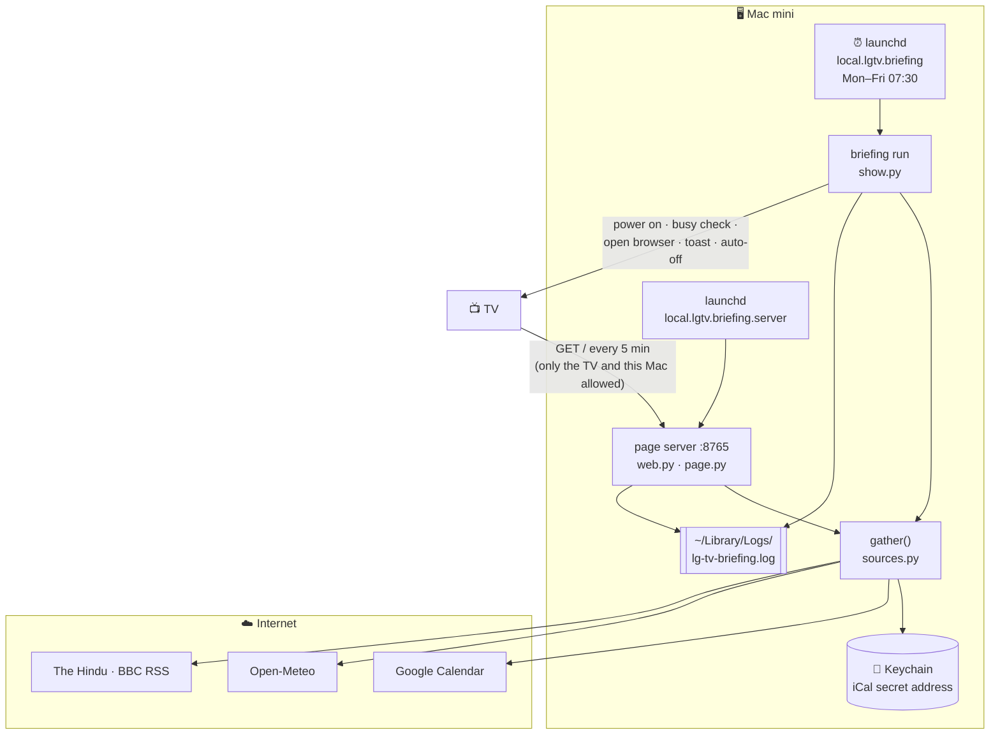
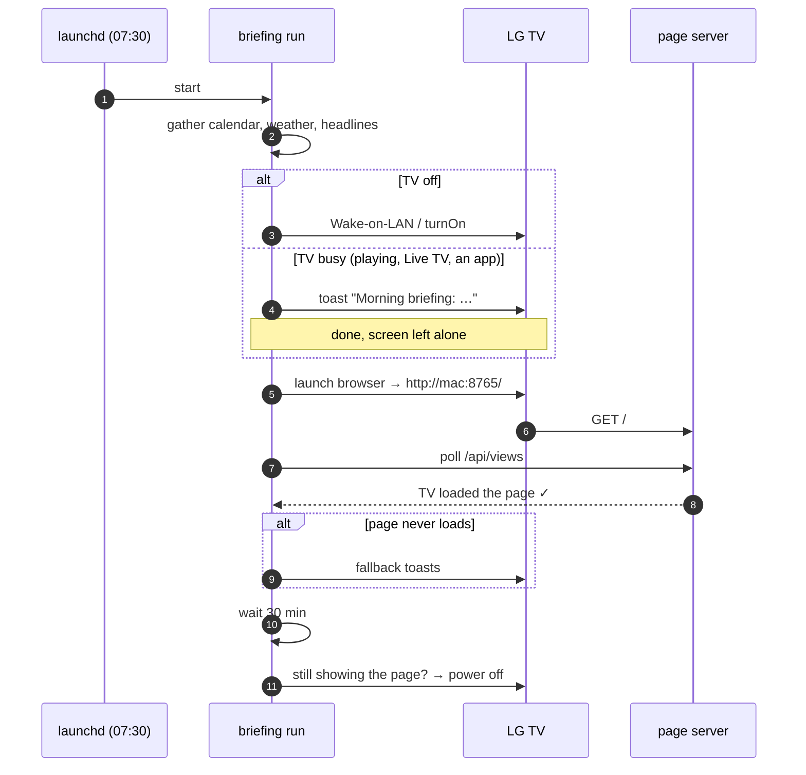

<div align="center">

# 📺 lgtv-mcp

**Let Claude run your LG TV over the home network, put on tonight's movie, and wake you up with a morning briefing.**

[](https://www.python.org/)
[](https://docs.astral.sh/uv/)
[](https://github.com/modelcontextprotocol/python-sdk)
[](https://github.com/home-assistant-libs/aiowebostv)
[](https://webostv.developer.lge.com/)
[](#)
[](#-tools)
[](LICENSE)

[Quick start](#-quick-start) · [Tools](#-tools) · [Movie night](#-movie-night) · [Scene capture](#-scene-capture) · [Morning briefing](#-morning-briefing) · [Architecture](#-architecture) · [Privacy](#-privacy-and-security) · [Troubleshooting](#-troubleshooting) · [Development](#-development)

</div>

---

A local [MCP](https://modelcontextprotocol.io) server that turns an LG webOS TV into something Claude can operate. Claude can:
- power the TV on and off
- open apps, YouTube videos and searches
- play a movie or episode in Netflix or Prime Video by name, getting past the "Who's watching?" screen
- change volume, inputs and channels
- press remote buttons
- show on-screen notifications

It talks to the TV over webOS's SSAP websocket (secure port 3001) through [aiowebostv](https://github.com/home-assistant-libs/aiowebostv), the library Home Assistant uses. It also wakes the TV with Wake-on-LAN.

With [Screenward](https://github.com/Laksh-star/screenward) alongside, `/movienight` goes from "a Malayalam feel-good film for the family" to the film playing. On top of that sits a **weekday morning briefing**: date, weather, today's calendar and headlines on the big screen at 07:30.

> Tested live on an **LG 55UT80406LA** (UT80, 2024), webOS 25 (10.3.2), from a Mac mini on the same Wi-Fi.

## ✨ Highlights

| | |
|---|---|
| 🔌 **Zero-config discovery** | Finds the TV with SSDP and reads its MAC from ARP. If DHCP moves the TV, it finds it again |
| 🔐 **Secrets stay local** | The pairing key is in `~/.config/lgtv/` (0600). The calendar address is in the macOS Keychain. Neither is in the repo |
| 🛟 **Readable failures** | "The TV is off (Active Standby). Call power_on first." instead of a stack trace |
| 🌅 **Morning briefing** | A 1080p dark page, shown in the TV's browser, that stays out of the way if you're already watching something |
| 🍎 **Native scheduling** | launchd agents, a `pmset` wake schedule and a rotating log file. No cron |

## 🚀 Quick start

```bash
git clone https://github.com/Laksh-star/lgtv-mcp.git && cd lgtv-mcp
uv sync
uv run lgtv-pair                 # finds the TV. Accept the prompt on screen within 60 s
```

`lgtv-pair 192.168.1.x --force` re-pairs with a specific IP.

Pairing writes `~/.config/lgtv/config.json` with `host`, `mac` and `client_key`. To override these, set `LGTV_HOST`, `LGTV_MAC` or `LGTV_CONFIG_DIR`.

### Connect it to Claude

<details open>
<summary><b>Claude Code</b></summary>

```bash
claude mcp add --scope user lgtv -- /opt/homebrew/bin/uv run --directory /path/to/lg-tv lgtv-mcp
claude mcp list     # lgtv: ✔ Connected
```
</details>

<details open>
<summary><b>Claude desktop app</b></summary>

The app keeps `claude_desktop_config.json` in memory and saves over outside edits while it runs. So **quit it fully (Cmd+Q)** first, then run:

```bash
/opt/homebrew/bin/uv run --directory /path/to/lg-tv python scripts/install_claude_desktop.py
```

The installer:
- refuses to run while the app is open
- backs up the config to `claude_desktop_config.json.bak-<timestamp>`
- adds only the `lgtv` entry, leaving other servers untouched
- writes absolute paths, because the app doesn't use your shell PATH

Reopen the app, and **lgtv** appears under Connectors. Its log is at `~/Library/Logs/Claude/mcp-server-lgtv.log`.
</details>

Then just ask: *"Turn on the TV and play lofi hip hop on YouTube."*

## 🧰 Tools

| Area | Tool | What it does |
|---|---|---|
| ⚡ Power | `power_on` | Wake-on-LAN, plus SSAP `turnOn` from standby. Waits until the TV is on (up to 30 s) |
| | `power_off` | Puts the TV in standby |
| | `screen_off` / `screen_on` | Panel off or on while audio keeps playing |
| ℹ️ Status | `get_status` | Power, current app, input, volume, mute, sound output, media play state, model |
| 🔊 Volume | `set_volume` · `volume_up` · `volume_down` · `mute` | Level 0–100, steps, mute/unmute/toggle |
| 🎛️ Inputs | `list_inputs` · `switch_input` | HDMI list with connected and active flags. Switch by id or label (`HDMI 3`) |
| 📱 Apps | `list_apps` · `launch_app` · `close_app` | Launch by id or title, with `content_id`, `params`, `youtube_video`, `youtube_search` |
| ▶️ Media | `media_control` | play · pause · stop · rewind · fast_forward |
| 📡 Live TV | `channel_up` · `channel_down` | Opens Live TV if needed and reports the new channel |
| 🎬 Movie night | `play_title` | Plays a movie or episode by TMDB id/title in Netflix or Prime Video (deep link + profile screen + Play), else opens the app with a toast. See [Movie night](#-movie-night) |
| 📸 Screen | `screenshot` | What's on the TV right now, as an image (app UI; video frames come out black) |
| 🎞️ Scenes | `capture_scene` · `annotate_scene` · `list_scenes` | Mark the scene on screen: two captures (the moment, then paused with title and timecode), saved as a scene card. See [Scene capture](#-scene-capture) |
| 🕹️ Remote | `press_button` | HOME, BACK, OK, arrows, MENU, digits, colours… with `repeat` |
| ⌨️ Text | `type_text` | Types into the focused field via the LG keyboard. YouTube ignores it, so use `youtube_search` there |
| 💬 Notify | `show_toast` | On-screen notification bubble |
| 🌅 Briefing | `show_briefing` | Shows the morning briefing now, turning the TV on if needed |

### Opening a specific title

`launch_app` passes `content_id` straight to the app, so a deep link can start a film instead of stopping at the app's home screen. Tested on the TV above:

| App | `content_id` | Status |
|---|---|---|
| Netflix | `m=https://www.netflix.com/watch/<NETFLIX_ID>&source_type=4` | ✅ Opens the title. Take the ID from the title's web URL (`netflix.com/title/<id>`) |
| YouTube | use `youtube_video` / `youtube_search` instead | ✅ |
| Prime Video, JioHotstar, Zee5 | | Not tested yet |

The app may stop at its "Who's watching?" profile screen first. Claude can't see the screen, so it can't pick a profile reliably.

> [!NOTE]
> With **TV On With Mobile** enabled, the TV usually sits in *Active Standby* after `power_off`, and `power_on` brings it back in about a second. After a while it can drop off the network entirely. Then Wake-on-LAN wakes it in about 15 seconds. Tools that need a lit screen refuse in standby rather than "succeeding" against a dark TV.

## 🎬 Movie night

`play_title` takes a **TMDB id** (or a title), an optional app, and `season`/`episode` for a series:

1. **Find the app's id.** Wikidata links TMDB ids to Netflix (P1874), Prime Video GTI (P14462) and JioHotstar (P11049) ids. No hit means `needs_lookup`: Claude web-searches the id and calls again with `app_content_id`. Every id is cached in `~/.config/lgtv/title_ids.json`.
2. **Deep-link, only into an installed app** (`list_apps`).
3. **Get it playing.** Netflix starts the film by itself, so OK is never pressed while something plays (it would pause it). Prime Video stops at "Who's watching?" and then the title page, so play_title presses OK for the profile, waits for the title page's trailer, then presses Play and checks that a new media session started.
4. **Log it** to `~/.config/lgtv/watch_history.json`, which `/movienight` uses to skip recent picks.

### Deep links on this TV (tested 17 Nov 2026)

| App | webOS id | Deep link | Launch payload / behaviour |
|---|---|---|---|
| Netflix | `netflix` | ✅ plays | `contentId: m=https://www.netflix.com/watch/<id>&source_type=4`. Starts the film behind an info overlay, about 6–20 s after launch. A show id starts or resumes the next-up episode |
| Prime Video | `amazon` | ✅ plays | `contentId: amzn1.dv.gti.<uuid>` (GTI only; a short `0PKD430…` detail id opens Home). Profile picker → title page → Play. Ads may play first |
| YouTube | `youtube.leanback.v4` | ✅ | `params.contentTarget: https://www.youtube.com/tv?v=<id>`, or a `"<title> full movie"` search |
| JioHotstar | `hotstar` | ❌ | Bare id, full URL, `hotstar://content/<id>`, `params.contentTarget`, `params.contentId`: all land on Home. Opened with a toast |
| ZEE5 | `com.zee5.app` | ❌ | Bare id, full URL, `params.contentTarget`: black screen with a spinner. Opened with a toast |

Netflix episode ids aren't on Wikidata or public pages, so an episode request opens the show (the tool says so in `note`). If `playback.result` is `not confirmed playing`, the reply includes a screen capture to look at.

### `/movienight`

[`.claude/skills/movienight/SKILL.md`](.claude/skills/movienight/SKILL.md) asks who's watching, the mood and the time available (only what you didn't already say). It checks which streaming apps the TV has and asks Screenward for a shortlist that streams in India on them. It shows 3 options with a one-line reason each, then calls `play_title` on the one you pick. Link it into your user skills to use it from anywhere:

```bash
ln -s "$PWD/.claude/skills/movienight" ~/.claude/skills/movienight
```

Screenward needs to be registered too:

```bash
claude mcp add --scope user screenward -e TMDB_BASE_URL=https://api.tmdb.org/3 -- /path/to/screenward/plugins/tmdb/scripts/run-server.sh
```

> [!TIP]
> On some Indian networks `api.themoviedb.org` resets most connections while `api.tmdb.org` (same API) answers every time. `TMDB_BASE_URL` points Screenward at it.

## 🎞️ Scene capture

Say **"mark this scene"** (with a note if you like) while something plays. `capture_scene`:

1. captures the **moment**: the clean frame, or the subtitle line in a streaming app;
2. pauses through the media API (confirmed `paused`) and captures again: the **player bar** with title and timecode;
3. resumes, unless you asked for `keep_paused`;
4. saves a scene card in `~/.config/lgtv/scenes/` with the title and TMDB id that `play_title` started, your note and both images.

Claude reads the images and fills in the card with `annotate_scene` (timecode, dialogue, a description). `list_scenes` hands the cards to whatever recreates the scenes.

What a TV capture can hold (tested 17 Nov 2026):

| Source | Picture | Subtitles | Paused: title + timecode |
|---|---|---|---|
| Netflix | ❌ black (protected video) | ✅ | ✅ `Juror #2 · 03:39 / 1:50:17` |
| Prime Video | ❌ black (protected video) | ✅ | ✅ `Sudani from Nigeria · 01:03 / 1:54:12` |
| YouTube | ✅ full frame | – | ✅ title and position |
| HDMI (set-top box) | ✅ full frame, channel graphics included | – | – (live, can't be paused from here) |
| Live TV | black (no aerial channels tuned on this TV) | – | – |

For a streaming film the card holds the words and the exact moment; add your own photo of the frame with `annotate_scene(photo=...)`, or use the poster from Screenward (`tmdb:///movie/<id>`).

## 🌅 Morning briefing

Every weekday at **07:30** the TV shows a full-screen page, refreshed every 5 minutes:

| Panel | Source |
|---|---|
| Day, date and a live clock | This Mac (Asia/Kolkata) |
| Weather now, high and low, chance of rain, sunrise and sunset | [Open-Meteo](https://open-meteo.com) (no API key) |
| Today's events, with the next one highlighted | Google Calendar secret iCal address, kept in the **Keychain** |
| 3 headlines each, India and World | RSS from The Hindu (National) and BBC News (World) |

**What a run does depends on the TV:**

| The TV is… | Result |
|---|---|
| ⚫ Off | Turns on, then opens the page in the webOS browser |
| 🏠 On Home or the screen saver | Opens the page |
| 🎬 Playing something, on Live TV or HDMI, or in an app | **Leaves the screen alone** and shows a toast: *"Morning briefing: 2 meetings today, next at 10:00 · 29°C, rain 0%"* |

- **Auto turn-off:** if the page is still on screen after 30 minutes, the TV turns off. If someone switched to something else, it stays on.
- **Fallback:** if the browser doesn't load the page, the briefing arrives as a few toasts instead.
- **One source failing doesn't stop the rest:** that panel says "unavailable", and the log records why.

### Commands

```bash
uv run briefing now                 # show it now, using the 07:30 rules (a toast if the TV is busy)
uv run briefing now --force         # take over the screen anyway
uv run briefing now --auto-off 1    # also test the auto turn-off after 1 minute
uv run briefing preview             # render the page to ~/Library/Caches/lg-tv-briefing/preview.html
uv run briefing status              # agents, Keychain check, wake schedule, recent log lines
uv run briefing install             # (re)install the launchd agents from the settings file
uv run briefing uninstall           # turn the briefing off
```

From Claude, say ***"show my briefing on the TV"***, which uses the `show_briefing` tool.

### Calendar setup (once)

1. Go to Google Calendar → ⚙️ **Settings** → your calendar → **Integrate calendar** → copy **Secret address in iCal format**.
2. Store it in the login Keychain. The command prompts for the address, so it never touches a file or your shell history:
   ```bash
   security add-generic-password -U -s lgtv-briefing -a google-calendar-ics -w
   ```
   If you saved it under another name in Keychain Access, set `keychain_service` and `keychain_account` (`""` means any account) under `[calendar]` in the settings file.
3. If macOS asks whether `security` may read the item, choose **Always Allow**, so the unattended 07:30 run can read it.

Repeating events, moved or skipped occurrences, all-day events and other time zones all resolve to local time. Cancelled and declined events are left out.

### Change the time or content

Everything lives in **`~/.config/lgtv/briefing.toml`**:

```toml
[location]               # weather city
name = "New Delhi"       # your city; find coordinates on open-meteo.com
latitude = 28.6139
longitude = 77.2090
timezone = "Asia/Kolkata"

[schedule]               # after editing, run:  uv run briefing install
weekdays = [1, 2, 3, 4, 5]   # 1 = Monday … 7 = Sunday
time = "07:30"
auto_off_minutes = 30        # 0 = never

[[feeds]]                # add, remove or reorder as you like
name = "India"
url = "https://www.thehindu.com/news/national/feeder/default.rss"
count = 3
```

Content changes appear within 5 minutes. Schedule changes need `uv run briefing install`, which also prints the matching `pmset` line.

### Wake the Mac first (optional)

```bash
sudo pmset repeat wakeorpoweron MTWRF 07:25:00     # check it with: pmset -g sched
```

This replaces any other repeating wake schedule. If the Mac is shut down, it powers on at that time, but the briefing only runs once you're logged in.

### Turn it off

```bash
uv run briefing uninstall     # removes both launchd agents
sudo pmset repeat cancel      # removes the Mac wake schedule
```

## 🏗️ Architecture

### Control path


### Morning briefing



### One scheduled run



### Project layout

```text
lg-tv/
├── src/lgtv_mcp/
│   ├── server.py              # MCP server: 26 tools, error handling
│   ├── play.py                # play_title: app table, deep links, profile screen / Play, screen capture
│   ├── scenes.py              # capture_scene / annotate_scene / list_scenes: scene cards
│   ├── titles.py              # TMDB id -> Netflix / Prime / JioHotstar ids via Wikidata, with a cache
│   ├── tv.py                  # connection, SSDP rediscovery, pairing, Wake-on-LAN, ensure_on()
│   ├── pair.py                # `lgtv-pair` CLI
│   └── briefing/
│       ├── cli.py             # `briefing now|run|serve|preview|install|uninstall|status`
│       ├── config.py          # briefing.toml, Keychain lookup, rotating log
│       ├── sources.py         # iCal (recurrence/timezones), Open-Meteo, RSS; each fails on its own
│       ├── page.py            # 1080p TV page (dark, large type, 5-min refresh, live clock)
│       ├── web.py             # aiohttp server with an IP allowlist
│       └── show.py            # busy check, browser launch + load confirmation, toasts, auto-off
├── .claude/skills/movienight/  # /movienight skill (Screenward + play_title)
└── scripts/
    └── install_claude_desktop.py
```

## 🔒 Privacy and security

Everything runs on your Mac and your home network. There is no cloud relay, and nothing listens on the internet.

- **Pairing key:** `~/.config/lgtv/config.json` (mode 0600). Anyone with this key on your network can control the TV, so treat it like a password. Delete it and run `uv run lgtv-pair --force` to re-pair; you can also remove the paired device on the TV.
- **Calendar:** the Google Calendar secret iCal address stays in the macOS Keychain. It grants read access to your calendar without a login, so if it ever leaks, reset it in Google Calendar settings.
- **Briefing page:** served on your LAN only, and the server answers just the TV, this Mac and any `allow_ips` you add. Don't port-forward it from your router.
- **What leaves the house:** weather requests to Open-Meteo (your configured coordinates), RSS fetches to the feeds you list, and the calendar fetch to Google, and `play_title`'s Wikidata lookups (a TMDB id or title, nothing about you). Claude sees whatever its tools return, such as app lists and your calendar events in a briefing.
- **Movie night:** `~/.config/lgtv/` also holds the title id cache, a play history (`watch_history.json`), the latest screen captures (`captures/`) and your scene cards (`scenes/`). Captures can show your streaming profiles' names and avatars, so don't commit or share them.
- **Not in this repo:** your TV's IP and MAC, the pairing key, the calendar address and your `briefing.toml`. Keep it that way if you fork it.

## 🧪 Compatibility

Tested on one TV: an **LG 55UT80406LA** (UT80, 2024) on **webOS 25 (10.3.2)**, controlled from a **Mac mini** on the same Wi-Fi.

- **Other LG TVs:** aiowebostv speaks the same SSAP protocol across webOS versions, so other models will probably work. They're untested; app ids, deep links and the browser app can differ.
- **macOS only for the briefing:** it relies on launchd, `pmset` and the Keychain. The MCP server itself is plain Python, but it's only been run on macOS.
- **Before pairing:** turn on *TV On With Mobile* (needed for `power_on`) and, for faster wake-ups, *Quick Start+*. Exact menu paths vary by webOS version.

Issues are welcome. Please include your TV model, webOS version and the relevant lines from the log.

## 🩺 Troubleshooting

| Symptom | Fix |
|---|---|
| A tool says the TV is off or unreachable while it's on | Check the Mac and the TV are on the same Wi-Fi. Run `get_status` again; it searches for the TV over SSDP if its IP changed |
| `lgtv` is missing from the desktop app's Connectors | Cmd+Q the app, run `scripts/install_claude_desktop.py`, then reopen |
| The briefing shows "Calendar unavailable" | `uv run briefing status` shows whether the Keychain item was found. The log gives the reason, e.g. an address Google has reset |
| The briefing came as toasts, not a page | Check `briefing.server` is `running` in `uv run briefing status`, and read the log for "never loaded" |
| `play_title` says `needs_lookup` | Wikidata has no id for that app. Claude can web-search it (`id_hint` says what to look for) and pass `app_content_id`. Or use `open_without_id: true` |
| A Netflix title opens on a page with **Remind Me** | It isn't streaming in India. Check `find_where_to_watch` in Screenward |
| Pairing prompt timed out | `uv run lgtv-pair --force`, then press OK on the TV within 60 s |

**Fixed IP (optional):** reserve the TV's IP for its MAC address (both in `~/.config/lgtv/config.json`) under *DHCP reservation* in your router's admin page.

## 🛠️ Development

```bash
uv run python -c "import asyncio; from lgtv_mcp.server import mcp; print([t.name for t in asyncio.run(mcp.list_tools())])"
uv run mcp dev src/lgtv_mcp/server.py      # MCP Inspector
uv run briefing preview                     # iterate on the TV page in a desktop browser
```

## 📄 License

[MIT](LICENSE). LG and webOS are trademarks of LG Electronics. This project is not affiliated with or endorsed by LG.

<div align="center"><sub>Built with Claude Code · runs entirely on your LAN, no cloud relay</sub></div>
