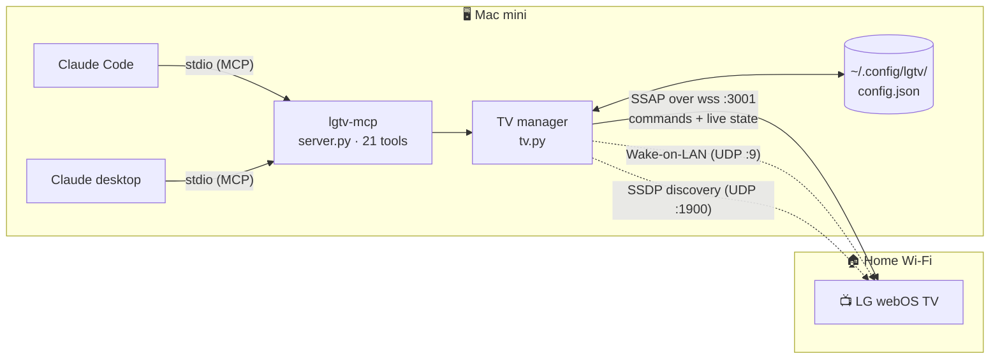
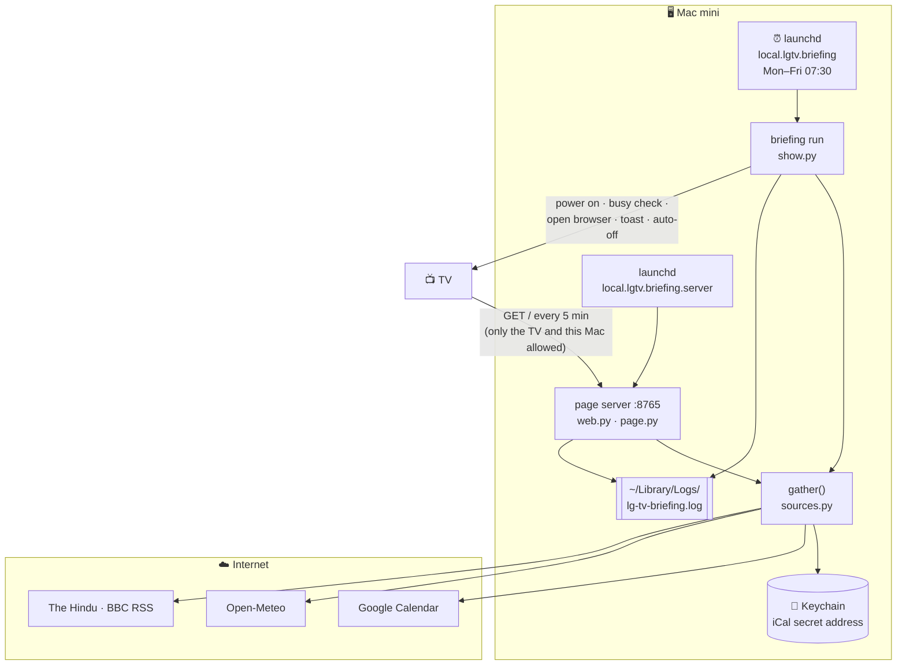
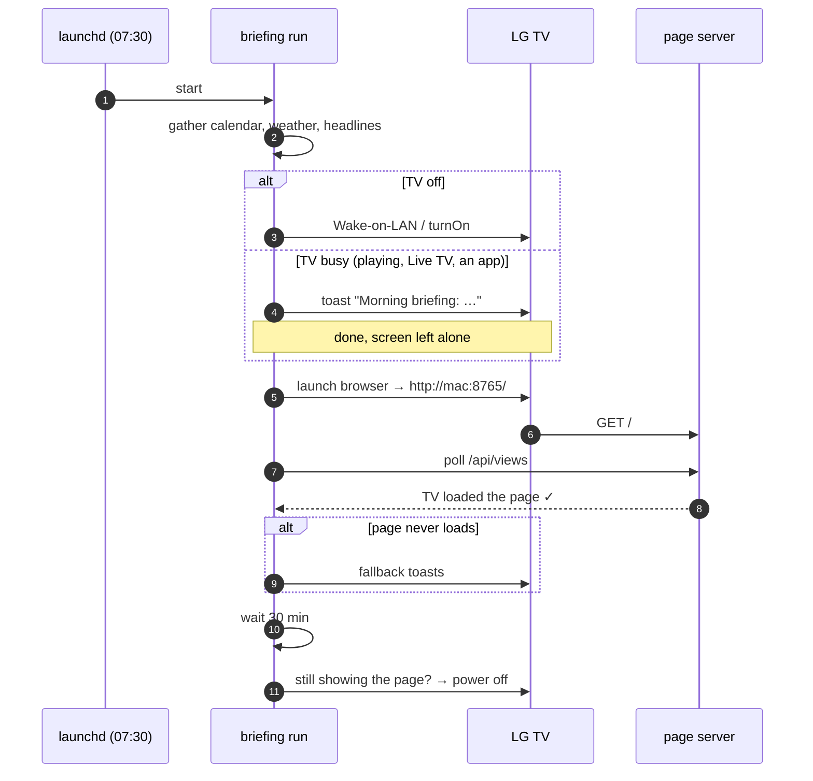

<div align="center">

# 📺 lgtv-mcp

**Let Claude run your LG TV over the home network, and wake you up with a morning briefing on it.**

[](https://www.python.org/)
[](https://docs.astral.sh/uv/)
[](https://github.com/modelcontextprotocol/python-sdk)
[](https://github.com/home-assistant-libs/aiowebostv)
[](https://webostv.developer.lge.com/)
[](#)
[](#-tools)

[Quick start](#-quick-start) · [Tools](#-tools) · [Morning briefing](#-morning-briefing) · [Architecture](#-architecture) · [Troubleshooting](#-troubleshooting) · [Development](#-development)

</div>

---

A local [MCP](https://modelcontextprotocol.io) server that turns an LG webOS TV into something Claude can operate. Claude can:
- power the TV on and off
- open apps, YouTube videos and searches
- change volume, inputs and channels
- press remote buttons
- show on-screen notifications

It talks to the TV over webOS's SSAP websocket (secure port 3001) through [aiowebostv](https://github.com/home-assistant-libs/aiowebostv), the library Home Assistant uses. It also wakes the TV with Wake-on-LAN.

On top of that sits a **weekday morning briefing**: date, weather, today's calendar and headlines on the big screen at 07:30.

> Tested live on an **LG 55UT80406LA** (UT80, 2024), webOS 25 (10.3.2), from a Mac mini on the same Wi-Fi.

## ✨ Highlights

| | |
|---|---|
| 🔌 **Zero-config discovery** | Finds the TV with SSDP and reads its MAC from ARP. If DHCP moves the TV, it finds it again |
| 🔐 **Secrets stay local** | The pairing key is in `~/.config/lgtv/` (0600). The calendar address is in the macOS Keychain. Neither is in the repo |
| 🛟 **Readable failures** | "The TV is off (Active Standby). Call power_on first." instead of a stack trace |
| 🌅 **Morning briefing** | A 1080p dark page, shown in the TV's browser, that stays out of the way if you're already watching something |
| 🍎 **Native scheduling** | launchd agents, a `pmset` wake schedule and a rotating log file. No cron |

## 🚀 Quick start

```bash
git clone https://github.com/Laksh-star/lgtv-mcp.git && cd lgtv-mcp
uv sync
uv run lgtv-pair                 # finds the TV. Accept the prompt on screen within 60 s
```

`lgtv-pair 192.168.1.x --force` re-pairs with a specific IP.

Pairing writes `~/.config/lgtv/config.json` with `host`, `mac` and `client_key`. To override these, set `LGTV_HOST`, `LGTV_MAC` or `LGTV_CONFIG_DIR`.

### Connect it to Claude

<details open>
<summary><b>Claude Code</b></summary>

```bash
claude mcp add --scope user lgtv -- /opt/homebrew/bin/uv run --directory /path/to/lg-tv lgtv-mcp
claude mcp list     # lgtv: ✔ Connected
```
</details>

<details open>
<summary><b>Claude desktop app</b></summary>

The app keeps `claude_desktop_config.json` in memory and saves over outside edits while it runs. So **quit it fully (Cmd+Q)** first, then run:

```bash
/opt/homebrew/bin/uv run --directory /path/to/lg-tv python scripts/install_claude_desktop.py
```

The installer:
- refuses to run while the app is open
- backs up the config to `claude_desktop_config.json.bak-<timestamp>`
- adds only the `lgtv` entry, leaving other servers untouched
- writes absolute paths, because the app doesn't use your shell PATH

Reopen the app, and **lgtv** appears under Connectors. Its log is at `~/Library/Logs/Claude/mcp-server-lgtv.log`.
</details>

Then just ask: *"Turn on the TV and play lofi hip hop on YouTube."*

## 🧰 Tools

| Area | Tool | What it does |
|---|---|---|
| ⚡ Power | `power_on` | Wake-on-LAN, plus SSAP `turnOn` from standby. Waits until the TV is on (up to 30 s) |
| | `power_off` | Puts the TV in standby |
| | `screen_off` / `screen_on` | Panel off or on while audio keeps playing |
| ℹ️ Status | `get_status` | Power, current app, input, volume, mute, sound output, media play state, model |
| 🔊 Volume | `set_volume` · `volume_up` · `volume_down` · `mute` | Level 0–100, steps, mute/unmute/toggle |
| 🎛️ Inputs | `list_inputs` · `switch_input` | HDMI list with connected and active flags. Switch by id or label (`HDMI 3`) |
| 📱 Apps | `list_apps` · `launch_app` · `close_app` | Launch by id or title, with `content_id`, `params`, `youtube_video`, `youtube_search` |
| ▶️ Media | `media_control` | play · pause · stop · rewind · fast_forward |
| 📡 Live TV | `channel_up` · `channel_down` | Opens Live TV if needed and reports the new channel |
| 🕹️ Remote | `press_button` | HOME, BACK, OK, arrows, MENU, digits, colours… with `repeat` |
| ⌨️ Text | `type_text` | Types into the focused field via the LG keyboard. YouTube ignores it, so use `youtube_search` there |
| 💬 Notify | `show_toast` | On-screen notification bubble |
| 🌅 Briefing | `show_briefing` | Shows the morning briefing now, turning the TV on if needed |

> [!NOTE]
> With **TV On With Mobile** enabled, the TV usually sits in *Active Standby* after `power_off`, and `power_on` brings it back in about a second. After a while it can drop off the network entirely. Then Wake-on-LAN wakes it in about 15 seconds. Tools that need a lit screen refuse in standby rather than "succeeding" against a dark TV.

## 🌅 Morning briefing

Every weekday at **07:30** the TV shows a full-screen page, refreshed every 5 minutes:

| Panel | Source |
|---|---|
| Day, date and a live clock | This Mac (Asia/Kolkata) |
| Weather now, high and low, chance of rain, sunrise and sunset | [Open-Meteo](https://open-meteo.com) (no API key) |
| Today's events, with the next one highlighted | Google Calendar secret iCal address, kept in the **Keychain** |
| 3 headlines each, India and World | RSS from The Hindu (National) and BBC News (World) |

**What a run does depends on the TV:**

| The TV is… | Result |
|---|---|
| ⚫ Off | Turns on, then opens the page in the webOS browser |
| 🏠 On Home or the screen saver | Opens the page |
| 🎬 Playing something, on Live TV or HDMI, or in an app | **Leaves the screen alone** and shows a toast: *"Morning briefing: 2 meetings today, next at 10:00 · 29°C, rain 0%"* |

- **Auto turn-off:** if the page is still on screen after 30 minutes, the TV turns off. If someone switched to something else, it stays on.
- **Fallback:** if the browser doesn't load the page, the briefing arrives as a few toasts instead.
- **One source failing doesn't stop the rest:** that panel says "unavailable", and the log records why.

### Commands

```bash
uv run briefing now                 # show it now, using the 07:30 rules (a toast if the TV is busy)
uv run briefing now --force         # take over the screen anyway
uv run briefing now --auto-off 1    # also test the auto turn-off after 1 minute
uv run briefing preview             # render the page to ~/Library/Caches/lg-tv-briefing/preview.html
uv run briefing status              # agents, Keychain check, wake schedule, recent log lines
uv run briefing install             # (re)install the launchd agents from the settings file
uv run briefing uninstall           # turn the briefing off
```

From Claude, say ***"show my briefing on the TV"***, which uses the `show_briefing` tool.

### Calendar setup (once)

1. Go to Google Calendar → ⚙️ **Settings** → your calendar → **Integrate calendar** → copy **Secret address in iCal format**.
2. Store it in the login Keychain. The command prompts for the address, so it never touches a file or your shell history:
   ```bash
   security add-generic-password -U -s lgtv-briefing -a google-calendar-ics -w
   ```
   If you saved it under another name in Keychain Access, set `keychain_service` and `keychain_account` (`""` means any account) under `[calendar]` in the settings file.
3. If macOS asks whether `security` may read the item, choose **Always Allow**, so the unattended 07:30 run can read it.

Repeating events, moved or skipped occurrences, all-day events and other time zones all resolve to local time. Cancelled and declined events are left out.

### Change the time or content

Everything lives in **`~/.config/lgtv/briefing.toml`**:

```toml
[location]               # weather city
name = "Hyderabad"
latitude = 17.385
longitude = 78.4867
timezone = "Asia/Kolkata"

[schedule]               # after editing, run:  uv run briefing install
weekdays = [1, 2, 3, 4, 5]   # 1 = Monday … 7 = Sunday
time = "07:30"
auto_off_minutes = 30        # 0 = never

[[feeds]]                # add, remove or reorder as you like
name = "India"
url = "https://www.thehindu.com/news/national/feeder/default.rss"
count = 3
```

Content changes appear within 5 minutes. Schedule changes need `uv run briefing install`, which also prints the matching `pmset` line.

### Wake the Mac first (optional)

```bash
sudo pmset repeat wakeorpoweron MTWRF 07:25:00     # check it with: pmset -g sched
```

This replaces any other repeating wake schedule. If the Mac is shut down, it powers on at that time, but the briefing only runs once you're logged in.

### Turn it off

```bash
uv run briefing uninstall     # removes both launchd agents
sudo pmset repeat cancel      # removes the Mac wake schedule
```

## 🏗️ Architecture

### Control path



### Morning briefing



### One scheduled run



### Project layout

```text
lg-tv/
├── src/lgtv_mcp/
│   ├── server.py              # MCP server: 21 tools, error handling
│   ├── tv.py                  # connection, SSDP rediscovery, pairing, Wake-on-LAN, ensure_on()
│   ├── pair.py                # `lgtv-pair` CLI
│   └── briefing/
│       ├── cli.py             # `briefing now|run|serve|preview|install|uninstall|status`
│       ├── config.py          # briefing.toml, Keychain lookup, rotating log
│       ├── sources.py         # iCal (recurrence/timezones), Open-Meteo, RSS; each fails on its own
│       ├── page.py            # 1080p TV page (dark, large type, 5-min refresh, live clock)
│       ├── web.py             # aiohttp server with an IP allowlist
│       └── show.py            # busy check, browser launch + load confirmation, toasts, auto-off
└── scripts/
    └── install_claude_desktop.py
```

## 🩺 Troubleshooting

| Symptom | Fix |
|---|---|
| A tool says the TV is off or unreachable while it's on | Check the Mac and the TV are on the same Wi-Fi. Run `get_status` again; it searches for the TV over SSDP if its IP changed |
| `lgtv` is missing from the desktop app's Connectors | Cmd+Q the app, run `scripts/install_claude_desktop.py`, then reopen |
| The briefing shows "Calendar unavailable" | `uv run briefing status` shows whether the Keychain item was found. The log gives the reason, e.g. an address Google has reset |
| The briefing came as toasts, not a page | Check `briefing.server` is `running` in `uv run briefing status`, and read the log for "never loaded" |
| Pairing prompt timed out | `uv run lgtv-pair --force`, then press OK on the TV within 60 s |

**Fixed IP (optional):** reserve the TV's IP for its MAC address (both in `~/.config/lgtv/config.json`) under *DHCP reservation* in your router's admin page.

## 🛠️ Development

```bash
uv run python -c "import asyncio; from lgtv_mcp.server import mcp; print([t.name for t in asyncio.run(mcp.list_tools())])"
uv run mcp dev src/lgtv_mcp/server.py      # MCP Inspector
uv run briefing preview                     # iterate on the TV page in a desktop browser
```

<div align="center"><sub>Built with Claude Code · runs entirely on your LAN, no cloud relay</sub></div>
