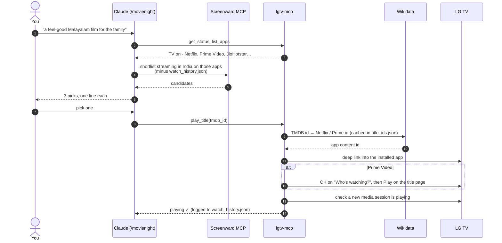
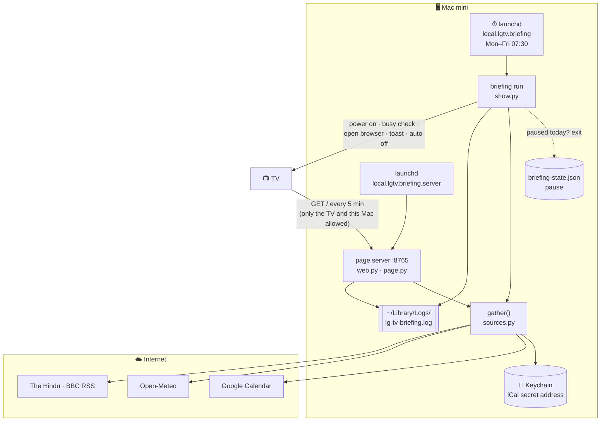
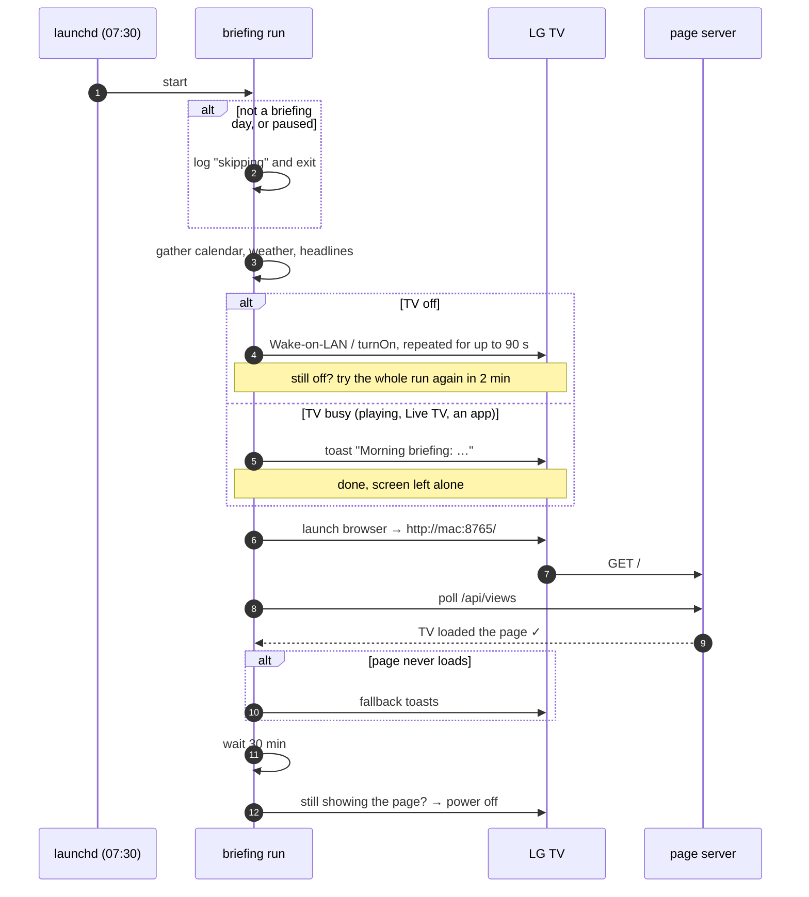
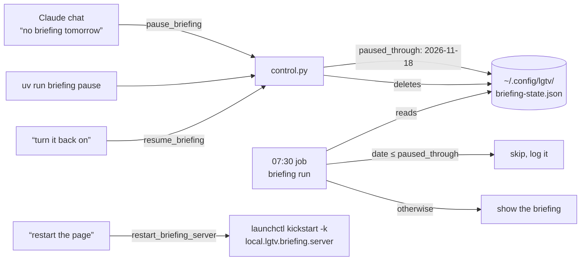

# Architecture

[← Back to the README](../README.md)

The overview above is the whole system on one page. The diagrams below zoom into each part:

- [Control path](#control-path): how a tool call reaches the TV
- [Movie night](#movie-night): from "what should we watch" to the film playing
- [Morning briefing](#morning-briefing): the scheduled jobs, the page server and the data sources
- [One scheduled run](#one-scheduled-run): what happens at 07:30
- [Briefing controls](#briefing-controls): pausing and resuming from chat

Everything runs on the Mac and the home network. The only traffic that leaves the house is outbound: weather, RSS, the calendar feed, Wikidata lookups and, through Screenward, TMDB.

## Control path

Claude starts `lgtv-mcp` as a stdio MCP server. The server keeps one SSAP websocket session to the TV, rediscovers it over SSDP if its IP changes (matched by MAC address), and wakes it with Wake-on-LAN.

- **Pairing key:** `~/.config/lgtv/config.json` (mode 0600) holds the TV's IP, MAC and client key.
- **Errors:** every TV or network failure becomes a short tool error ("the TV is off", "the TV didn't answer in time"), never a stack trace. Tools that need a lit screen refuse while the TV is in standby.

## Movie night

`/movienight` is a skill that uses two MCP servers: Screenward picks the film, and `lgtv` plays it.

If Wikidata has no id, `play_title` answers `needs_lookup`, Claude web-searches the id and calls again with `app_content_id`. Apps with no working deep link (JioHotstar, ZEE5) open with a toast instead.

## Morning briefing

Two launchd agents run the briefing: a calendar job at 07:30 on weekdays, and a page server that is always up. Both gather the same data; each source fails on its own, and the page shows "unavailable" for just that part.

The Mac wakes at 07:25 (`pmset repeat wakeorpoweron`), five minutes before the job.

## One scheduled run

## Briefing controls

`pause_briefing`, `resume_briefing`, `briefing_status` and `restart_briefing_server` (and the matching `briefing` commands) all go through `control.py`. A pause is a single date, the last day to skip, so it ends by itself.

Changing the time or the days isn't a chat command: edit `~/.config/lgtv/briefing.toml`, run `uv run briefing install`, and set a matching `sudo pmset` wake time.
