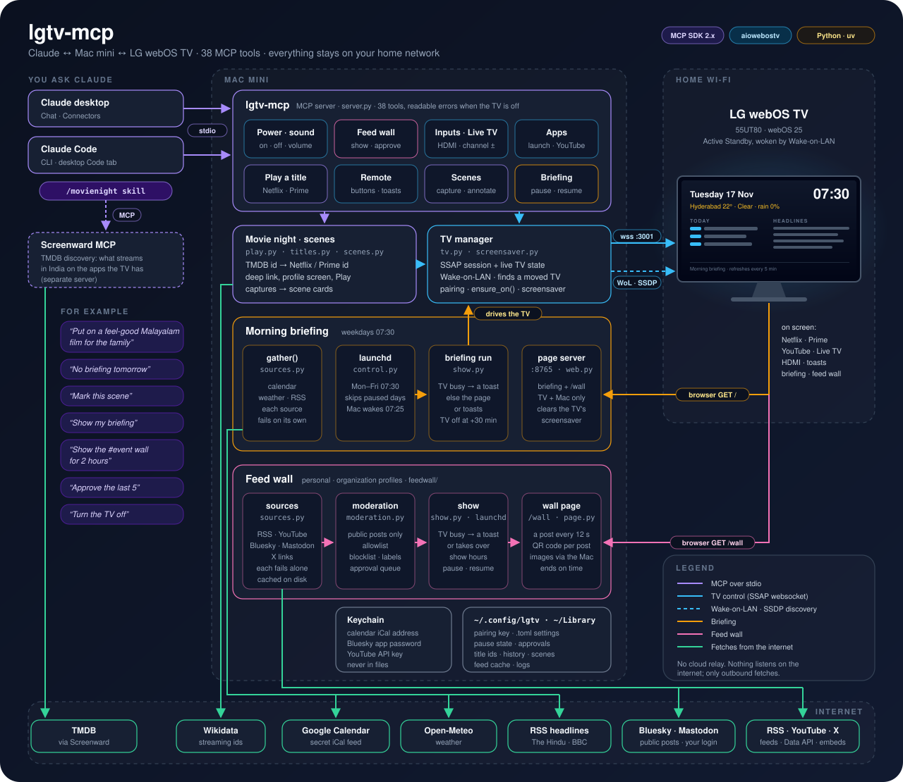
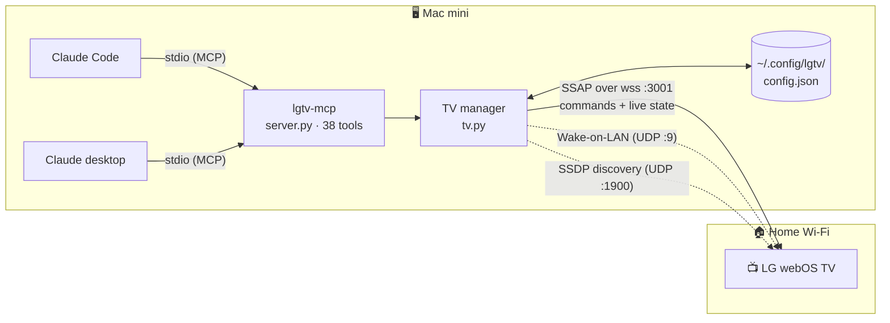
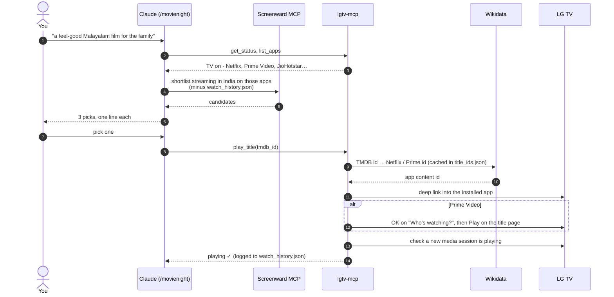
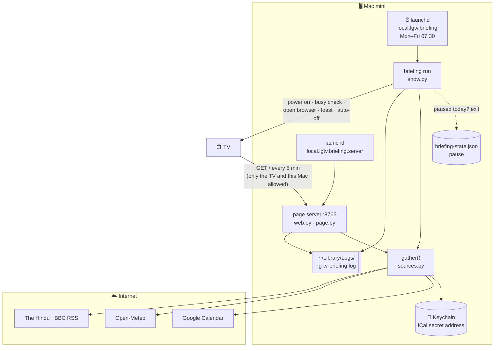
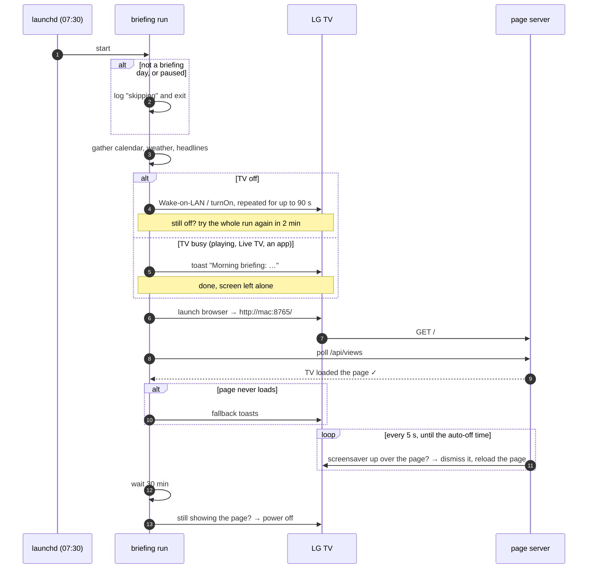
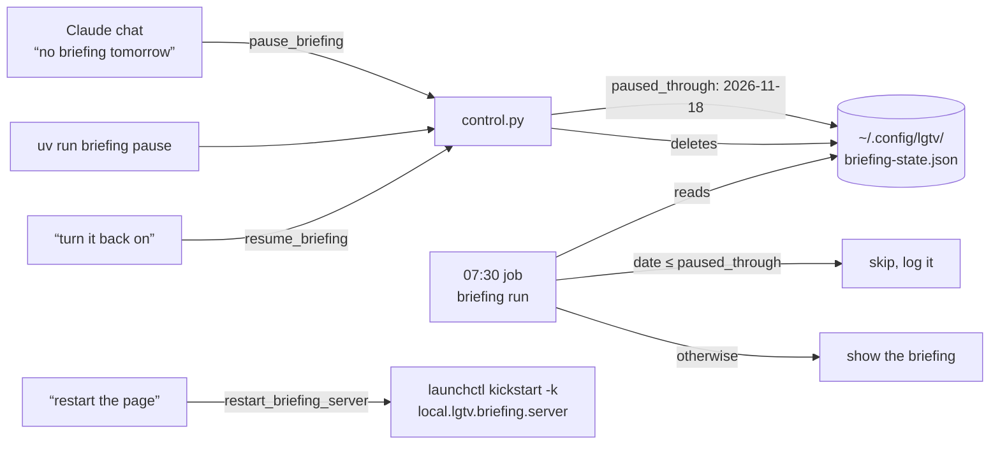
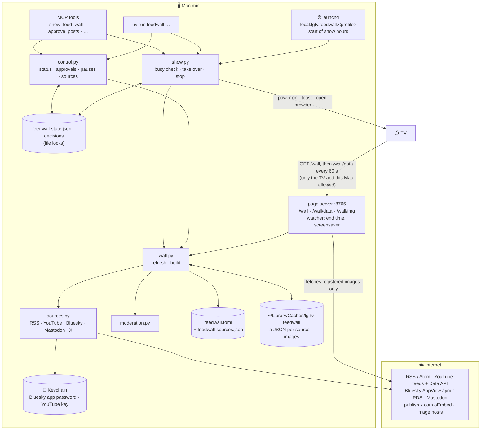
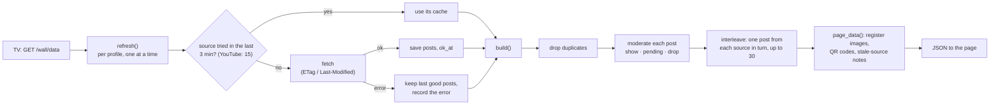
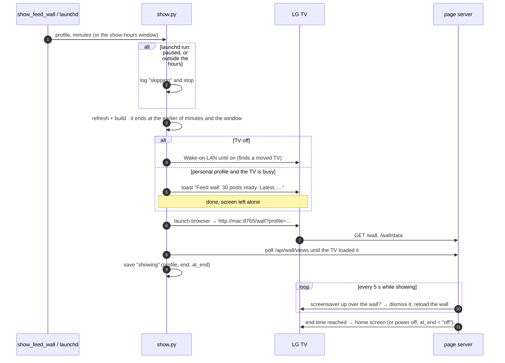
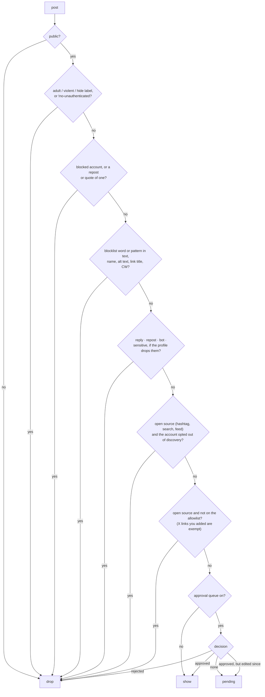

# Architecture

[← Back to the README](../README.md)

The overview above is the whole system on one page. The diagrams below zoom into each part:

- [Control path](#control-path): how a tool call reaches the TV
- [Movie night](#movie-night): from "what should we watch" to the film playing
- [Morning briefing](#morning-briefing): the scheduled jobs, the page server and the data sources
- [One scheduled run](#one-scheduled-run): what happens at 07:30
- [Briefing controls](#briefing-controls): pausing and resuming from chat
- [Feed wall](#feed-wall): sources, moderation, the wall page and its schedule
- [One wall refresh](#one-wall-refresh): from the sources to the posts on screen
- [Showing and ending a wall](#showing-and-ending-a-wall): busy check, takeover, end time, screensaver
- [Moderation order](#moderation-order): which rule drops, holds or shows a post
- [The TV's screensaver](#the-tvs-screensaver): why the page server keeps clearing it

Everything runs on the Mac and the home network. The only traffic that leaves the house is outbound: weather, RSS, the calendar feed, Wikidata lookups, the feed wall's sources and the images on the wall, and, through Screenward, TMDB.

## Control path

Claude starts `lgtv-mcp` as a stdio MCP server. The server keeps one SSAP websocket session to the TV, rediscovers it over SSDP if its IP changes (matched by MAC address), and wakes it with Wake-on-LAN.

- **Pairing key:** `~/.config/lgtv/config.json` (mode 0600) holds the TV's IP, MAC and client key.
- **A TV that moved:** the router can give the TV a new address while it's off. `TV.reachable()` tries the saved address, then looks for the TV over SSDP and saves the new one. While waking the TV, `ensure_on()` searches like this every 8 s, so a TV that comes up at a new address is still found.
- **Shutting down:** for about 2 minutes after a power-off the TV keeps its ports open but closes every connection (WebSocket code 1008). That counts as "unavailable", not a crash.
- **Errors:** every TV or network failure becomes a short tool error ("the TV is off", "the TV didn't answer in time"), never a stack trace. Tools that need a lit screen refuse while the TV is in standby.

## Movie night

`/movienight` is a skill that uses two MCP servers: Screenward picks the film, and `lgtv` plays it.

If Wikidata has no id, `play_title` answers `needs_lookup`, Claude web-searches the id and calls again with `app_content_id`. Apps with no working deep link (JioHotstar, ZEE5) open with a toast instead.

## Morning briefing

Two launchd agents run the briefing: a calendar job at 07:30 on weekdays, and a page server that is always up. Both gather the same data; each source fails on its own, and the page shows "unavailable" for just that part. The page server also serves the [feed wall](#feed-wall) and [keeps the TV's screensaver off](#the-tvs-screensaver) both pages.

The Mac wakes at 07:25 (`pmset repeat wakeorpoweron`), five minutes before the job.

## One scheduled run

## Briefing controls

`pause_briefing`, `resume_briefing`, `briefing_status` and `restart_briefing_server` (and the matching `briefing` commands) all go through `control.py`. A pause is a single date, the last day to skip, so it ends by itself.

Changing the time or the days isn't a chat command: edit `~/.config/lgtv/briefing.toml`, run `uv run briefing install`, and set a matching `sudo pmset` wake time.

## Feed wall

The feed wall reuses the briefing's pieces: the page server, the TV-only guard, the busy check, launchd and the Keychain. Two profiles decide how it behaves: **personal** never takes over a busy TV (a toast instead), and **organization** takes over a dedicated screen during its show hours with strict moderation.

- **Sources fail on their own.** Each source's last good posts are kept in its own JSON file. A source that fails keeps showing them, and the wall's footer says when it last updated.
- **Images go through the Mac.** The TV only ever talks to the Mac. `/wall/img/<key>` serves images the wall registered (no open proxy), capped at 8 MB and cached for 7 days.
- **The page is locked down.** Post text is set with `textContent` only, and the page sends a strict Content-Security-Policy.
- **Credentials** come only from the Keychain. A Bluesky login is saved there too and refreshed, because `createSession` is limited to 10 a day.

## One wall refresh

The page asks for `/wall/data` every 60 s. Each request refreshes the sources that are due and rebuilds the wall from their latest fetch, so a deleted post disappears and an edited one goes back for approval within one refresh.

The page rotates a post every 12 s and remembers the post it was on, so a reload carries on from there instead of starting over.

## Showing and ending a wall

`stop_feed_wall` ends it the same way at once. If someone has switched to something else by then, the TV is left alone.

## Moderation order

`moderation.py` decides each post in this order; the first rule that matches wins. The always-on rules apply to both profiles; the rest are profile settings, strict by default for organization.

Approvals live in `~/.config/lgtv/feedwall-decisions.json` with the post's revision, so an edit sends it back to the queue.

## The TV's screensaver

webOS puts up its screensaver about 3 minutes after the last remote input, even over a page that keeps changing. There's no way to prevent it: `turnOnScreen` is refused while the screen is active and only dismisses the screensaver once it's up. After that the browser stays black until the page is opened again.

So the page server watches while one of its pages is on screen, using `screensaver.py`:

| Page | Watched while | Then |
|---|---|---|
| Feed wall | a wall is "showing" and the TV loaded it in the last 150 s | dismiss, reload the wall (it carries on from the post it was on) |
| Briefing | the TV keeps reloading it (every 5 min), more recently than the wall, and for up to its auto-off time (30 min when auto-off is 0) | dismiss, reload the briefing |

It checks every 5 s, so the screensaver shows for a few seconds at most. If the TV is off or unreachable, it waits a minute before trying again. After a page-server restart the briefing is picked up at the TV's next 5-minute reload.
